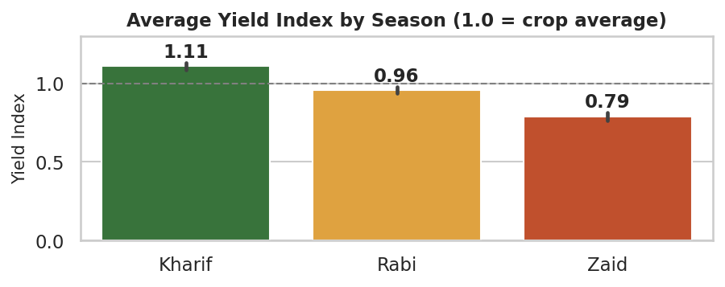
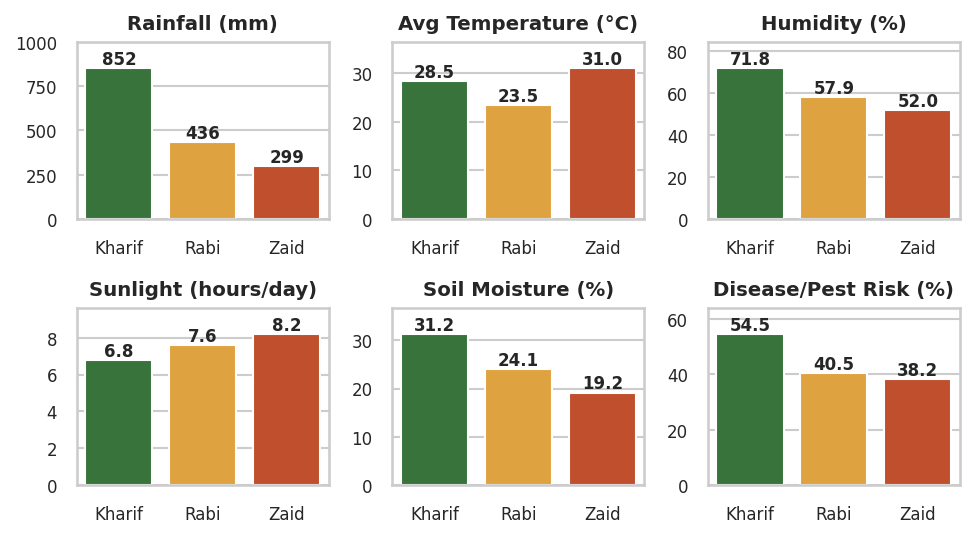
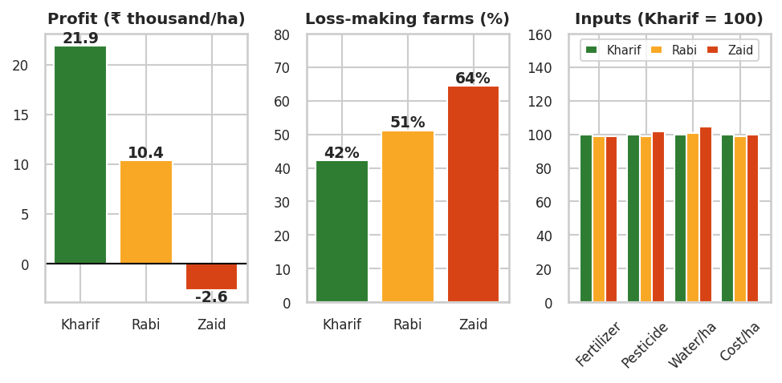
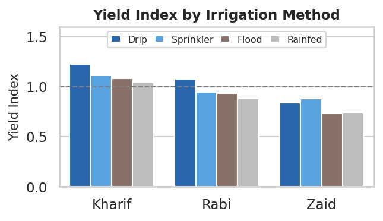

# 🌾 Seasonal Agriculture Performance Analysis

**VOIS AICTE Batch 1 (2026-2027) · Major Project · Data Analytics**

An end-to-end data-analytics project that studies how agricultural performance changes across the three Indian crop seasons — **Kharif, Rabi and Zaid** — using a dataset of **4,000 farms, 8 states, 8 crops and 28 attributes**.

---

## 📌 Problem Statement
Agricultural performance is shaped by seasonal changes in environment, farming practices, resource availability and markets. Raw data does not show *how* performance shifts between seasons. This project analyses the dataset to find **meaningful seasonal patterns, trends, relationships and variations**, and turns them into evidence-based recommendations.

## 🎯 Objectives
- Explore, clean and prepare the dataset
- Compare yield, resource use and profitability across seasons
- Relate seasonal environmental conditions to outcomes
- Check whether patterns hold across crops, states and irrigation methods
- Identify unusual patterns and give data-driven recommendations

## 🗂️ Repository Structure
```
.
├── data/
│   ├── seasonal_agriculture_performance_dataset.csv   # raw data (4,000 rows)
│   └── cleaned_agriculture_data.csv                   # cleaned + engineered features
├── notebooks/
│   └── Seasonal_Agriculture_Performance_Analysis.ipynb  # complete analysis (executed)
├── images/                                            # all generated charts
├── docs/
│   └── VOIS_Major_Project_Seasonal_Agriculture_Performance_Analysis.pptx
├── requirements.txt
└── README.md
```

## 🧹 Data Cleaning & Preparation
| Issue | Action |
|---|---|
| `Yield_Tonnes_Ha` – 32 missing | Recomputed as `Production_Tonnes / Farm_Area_Hectares` (relationship verified exact) |
| `Rainfall_mm` – 48 missing, `Soil_Moisture_pct` – 40 missing | Filled with **season-wise median** |
| Duplicates / integrity | 0 duplicates; Production, Revenue and Profit identities all consistent |
| Crop scale (Sugarcane ≈ 47 t/ha vs 1–3 t/ha) | Built a crop-normalised **Yield Index** (1.0 = crop average) |
| `District` inconsistent with `State` | Geographic analysis done at State level only |
| New features | `Yield_Index`, `Profit_per_ha`, `Cost_per_ha`, `Revenue_per_ha`, `Water_per_ha`, `Loss_Making`, `Yield_Outlier` |

## 🔍 Key Findings
| Metric | Kharif | Rabi | Zaid |
|---|---|---|---|
| Yield Index (1.0 = crop avg) | **1.11** | 0.96 | 0.79 |
| Avg rainfall (mm) | 852 | 436 | 299 |
| Avg temperature (°C) | 28.5 | 23.5 | 31.0 |
| Disease / pest risk (%) | 54.5 | 40.5 | 38.2 |
| Avg profit per ha (₹) | 21,882 | 10,362 | –2,637 |
| Loss-making farms | 42% | 51% | 64% |

1. **Yield falls Kharif → Rabi → Zaid** (Zaid ≈ 29% below Kharif; Kruskal-Wallis p ≈ 2×10⁻⁵⁶). The same order holds for **all 8 crops and all 8 states**.
2. **Environment differs sharply** — Kharif is wet, humid and pest-prone; Zaid is hot, dry and sunny.
3. **Inputs do not change by season** — fertilizer, pesticide, water and cost per hectare are statistically identical (p > 0.05), so the same inputs yield much less in Zaid.
4. **Economics follow yield, not price** — market price is flat across seasons (p = 0.94).
5. **Rainfall flips sign** — negative association with yield in Kharif (ρ = –0.19), positive in Rabi (+0.27) and Zaid (+0.31).
6. **Irrigation matters in every season** — drip is best in Kharif/Rabi (+18% / +22% vs rainfed); sprinkler leads in Zaid.
7. **Chilli and Sugarcane** stay profitable in all seasons; **Wheat, Rice and Maize** are loss-making on most farms, especially in Zaid (85–92%).

### Sample charts
| | |
|---|---|
|  |  |
|  |  |

## ✅ Recommendations
1. Plan crop portfolios seasonally — Chilli and Sugarcane profit year-round; treat Wheat, Rice and Maize in Zaid as high-risk.
2. Prioritise drip irrigation in Kharif/Rabi and sprinkler/drip in Zaid over flood or rainfed.
3. Adopt season-specific input plans (heat/drought management in Zaid, drainage and pest control in Kharif).
4. Strengthen pest surveillance in Kharif, when risk peaks (~54%).
5. Investigate the cost–price gap for Wheat and Rice.

## 🛠️ Technology Used
Python 3 · Pandas · NumPy · Matplotlib · Seaborn · SciPy · Jupyter Notebook · Git & GitHub

## ▶️ How to Run
```bash
git clone <your-repo-url>
cd <your-repo-folder>
pip install -r requirements.txt
jupyter notebook notebooks/Seasonal_Agriculture_Performance_Analysis.ipynb
```
Run the notebook from the `notebooks/` folder (paths are relative). Charts are re-saved to `images/`.

## ⚠️ Limitations
- The dataset appears synthetic (e.g. district names do not match states), so results should be validated on real records.
- Single observation per farm — year-on-year trends cannot be studied.
- Findings are associations, not proof of causation.

## 🔮 Future Scope
Predictive yield/profit models, multi-year data, an interactive Power BI / Streamlit dashboard, and a seasonal crop-recommendation system.
